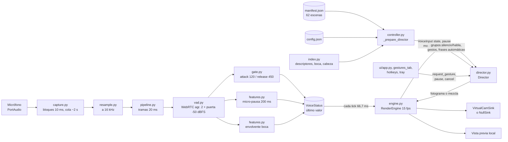
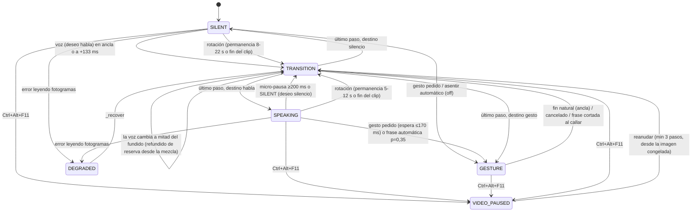

# Análisis forense de la lógica de CamVoice (sin modificaciones)

## 1. Portada técnica

| Campo | Valor |
|---|---|
| Documento | `docs/ANALISIS_FORENSE_LOGICA_CAMVOICE.md` |
| Encargo | `docs/PROMPT_AUDITORIA_LOGICA_CAMVOICE_SIN_MODIFICACIONES.md` |
| Fecha | 2026-10-31 |
| Repositorio | `D:\Git-Hub\camvoice`, rama `main`, HEAD `618b6fe` (2026-10-18) más un árbol de trabajo con muchos cambios sin commit: 18 archivos modificados y unos 35 sin seguimiento (ver §19.3) |
| Código auditado | El **árbol de trabajo actual**, no HEAD |
| Datos del usuario | `%APPDATA%\camvoice\config.json` y `%APPDATA%\camvoice\library\manifest.json` (62 escenas). Grabaciones en `C:\Users\USUARIO\Pictures\Camera Roll` |
| Equipo | Windows 11 Pro, Python 3.12.10 (`.venv`) |
| Método | Solo lectura estática: lectura de archivos, `grep`, listados y `git status`. **No** se ejecutaron pruebas, ni la aplicación, ni ningún comando que escriba |
| Archivos modificados por esta auditoría | Solo este documento |

**Clasificación de cada conclusión:**

| Etiqueta | Significado |
|---|---|
| **[CÓDIGO]** | Confirmado por código |
| **[CONFIG]** | Confirmado por configuración o manifiesto |
| **[REGISTRO]** | Observado en una prueba o registro existente, **anterior** a esta auditoría |
| **[HIPÓTESIS]** | Hipótesis con evidencia parcial |
| **[NVE]** | No verificable sin ejecución o sin dispositivo |

Las referencias `ruta:Lx-Ly` son relativas a la raíz del repositorio, salvo las rutas de `%APPDATA%`.

---

## 2. Resumen ejecutivo

CamVoice muestra clips pregrabados según un estado de voz binario: **habla** o **silencio**. El audio decide **qué grupo de clips** se reproduce y **cuándo** se cambia. No hay sincronía labial. La boca del vídeo no sigue a la voz: el nivel de la voz (`mouth`) llega al director, pero el director no lo usa (`camvoice/video/director.py:L56-57`, `L99-109`, `L722-724`) **[CÓDIGO]**.

Los dos síntomas que motivan la auditoría tienen explicación en el código y la configuración actuales.

**1. Manos y movimientos durante el habla continua.**
- El grupo de habla tiene 11 clips: #2, 4, 5, 19, 20, 21, 22, 38, 39, 40 y 41.
- Entre ellos están **#38 «Hablar con una mano»** y **#39 «Hablar con ambas manos»**, que por su descripción gesticulan con las manos, y #40 «Hablar consultando notas» **[CÓDIGO + CONFIG]**.
- El grupo se arma **solo por categoría** (`SPEAKING_VARIATION`). No se mira el contenido (`camvoice/video/library.py:L182-192`).
- Además, con `auto_speaking_shots` activo por defecto, se lanzan **solas** las frases #7 y #8 al empezar a hablar (probabilidad 0,35) y #6 como cierre en intervenciones largas (`director.py:L286-296`, `L677-700`, `L783-792`). La documentación del catálogo las describe como «a petición» (`camvoice/scenes.py:L11-12`). Esa opción no aparece en `config.json` ni en la interfaz **[CÓDIGO + CONFIG]**.

**2. Transiciones bruscas o raras.** Se suman varios mecanismos confirmados en el código:
- **(a) Las micro-pausas cuentan como silencio.** Una pausa de solo **200 ms** dentro de una frase hace que el director pida el grupo de silencio, aunque la puerta de voz siga en SPEAKING (`director.py:L722-724`, `camvoice/audio/features.py:L95-128`, `camvoice/audio/pipeline.py:L329`). En el habla natural esto provoca idas y vueltas habla → silencio → habla **[CÓDIGO]**. Que ocurra con la frecuencia que perciben los usuarios es **[HIPÓTESIS]**.
- **(b) Hablar → callar casi nunca encuentra ancla.** Termina en el fundido de reserva: 3 pasos, de los que solo 2 son fotogramas mezclados (≈133 ms visibles). En los ensayos registrados ocurrió en **19 de 20** casos **[CÓDIGO + REGISTRO]**.
- **(c) Si la voz cambia a mitad de un fundido, se reinicia el fundido** desde el fotograma ya mezclado, hacia el otro grupo (`director.py:L1014-1021`). En la simulación de 2 h hubo **486 transiciones interrumpidas de 2238** **[CÓDIGO + REGISTRO]**.
- **(d) El fundido es un fundido cruzado de imagen completa** (`cv2.addWeighted`, `director.py:L1047-1051`). Entre poses distintas se ve doble exposición. El morph por flujo óptico está desactivado (`transition_morph` off) **[CÓDIGO + CONFIG]**.
- **(e) Las anclas son relativas a cada clip** (cuantiles de boca y pose), no a una pose neutra absoluta (`director.py:L834-865`). Un clip con las manos levantadas casi todo el tiempo sigue teniendo «anclas» **[CÓDIGO]**.
- **(f) 19 gestos no empiezan o no terminan en la pose neutra.** Lo avisa la propia preparación **[REGISTRO]**.

**Otros hallazgos:**
- Los ejecutables de `dist/` (2026-10-18) son **anteriores** al modo director, los gestos y la biblioteca: no contienen esos módulos **[CONFIG]**.
- La semilla aleatoria es `null`, así que el comportamiento no se repite de una ejecución a otra **[CONFIG + CÓDIGO]**.
- Hay varios textos que contradicen el código: `index.py` habla de «guiar la boca con la voz»; `controller.py` avisa de que «la boca no podrá seguir a la voz»; `config.py` dice que «la boca se cierra sola» **[CÓDIGO]**.

---

## 3. Inventario de módulos

| Módulo | Función | Estado git | Relevancia |
|---|---|---|---|
| `camvoice/__main__.py` | Punto de entrada; sin argumentos abre la interfaz (`cli.py:L1387-1393`) | sin cambios | Media |
| `camvoice/cli.py` | Subcomandos: gui, run, prepare, index, transitions, library, gestures, soak, etc. (`L1230-1382`) | M | Media |
| `camvoice/config.py` | Dataclasses de configuración, migración y validación | M | Alta |
| `camvoice/controller.py` | `Session`: prepare, `_prepare_director`, start, stop | M | Alta |
| `camvoice/audio/capture.py` | Captura PortAudio, cola de unos 2 s | sin cambios | Media |
| `camvoice/audio/resample.py` | FIR sinc, conversión a int16, RMS en dBFS | sin cambios | Baja |
| `camvoice/audio/vad.py` | `EnergyDetector` y `WebrtcDetector` | sin cambios | Alta |
| `camvoice/audio/gate.py` | `SpeechGate`: histéresis temporal SILENT/SPEAKING | sin cambios | Alta |
| `camvoice/audio/features.py` | `MouthEnvelope` (solo métrica) y `MicroPauseDetector` | ?? (nuevo) | **Muy alta** |
| `camvoice/audio/pipeline.py` | Hilo de audio; publica `VoiceStatus` | M | Alta |
| `camvoice/video/engine.py` | `RenderEngine`: Pacer de 15 fps, `_tick`, emisión | M | Alta |
| `camvoice/video/director.py` | Máquina de estados, anclas, transiciones, frases automáticas | ?? | **Muy alta** |
| `camvoice/video/index.py` | Descriptores 32×24, `d_ok`, boca y cabeza por Haar | ?? | Alta |
| `camvoice/video/library.py` | Manifiesto; `pools`, `speaking_actions`, `active_gestures` | ?? | Alta |
| `camvoice/video/importer.py` | Importación de las 62 grabaciones por número | ?? | Media |
| `camvoice/video/normalize.py` | Normalización ECC y color Lab respecto al clip de silencio | ?? | Media |
| `camvoice/video/cache.py` | Caché de fotogramas (`clipcache`) | M | Baja |
| `camvoice/video/trials.py` | Ensayos de transición con reloj simulado | ?? | Media |
| `camvoice/scenes.py` | Catálogo de las 62 escenas y sus categorías | ?? | **Muy alta** |
| `camvoice/gestures.py` | Gestos por defecto y atajos Ctrl+Alt+F1…F8 | ?? | Media |
| `camvoice/soak.py` | Simulación larga y medición en tiempo real | ?? | Media |
| `camvoice/ui/app.py` | Ventana principal y pestañas | M | Media |
| `camvoice/ui/gestures_tab.py`, `library_tab.py`, `hotkeys.py`, `tray.py` | Pestañas Gestos y Biblioteca, atajos globales, bandeja | ?? / M | Media |
| `dist/camvoice/*.exe` | Ejecutables empaquetados el 2026-10-18 10:42 | — | **Obsoletos** (§5.4) |

---

## 4. Arquitectura

Fuentes **[CÓDIGO]**:
- `controller.py:L352-388`: creación del Director, el audio y el motor.
- `engine.py:L176-186`: `_to_voice_input`.
- `engine.py:L306-334`: `_tick`.
- `engine.py:L372-381`: `_compose`.
- `pipeline.py:L279-331`: troceado en tramas y publicación.

---

## 5. Inicio, ciclo de vida y apagado

### 5.1 Arranque
1. `python -m camvoice` llega a `cli.main`. Sin subcomando se convierte en `gui` (`cli.py:L1387-1393`), y `cmd_gui` llama a `run_gui` (`cli.py:L1106-1110`, `ui/app.py:L1634-1640`) **[CÓDIGO]**.
2. Hay tres formas de arrancar la sesión **[CÓDIGO]**:
   - «Iniciar vista previa» (`ui/app.py:L294-301`).
   - «Iniciar cámara virtual» (`L303-307`).
   - «Iniciar» en la bandeja (`ui/tray.py:L99-131`), que arranca la cámara **virtual**.
3. `_on_start` (`app.py:L1351-1385`): recoge la configuración, la valida y lanza `PrepareWorker` en un QThread **[CÓDIGO]**.
4. `Session.prepare` (`controller.py:L116-181`) **[CÓDIGO]**:
   - Prepara los clips de silencio y habla. La normalización usa como referencia el clip de silencio.
   - Ejecuta `_prepare_director` (`L205-302`).
   - **Si el director falla, vuelve al modo clásico con un aviso** (`L171-175`).
5. `_prepare_director` **[CÓDIGO]**:
   - `load_library(cfg)` (`L207`).
   - Grupos con `lib.pools(cfg)` (`L210`) y frases con `speaking_actions()` (`L211`).
   - Índices con `load_or_build_index` (`L231`) y gestos con `active_gestures()` (`L266-271`).
   - Avisos sobre clips sin rango de boca (`L297-300`).
6. `Session.start` (`controller.py:L352-388`) **[CÓDIGO]**:
   - Crea el `Director(..., gestures_cfg=self.cfg.gestures)`. Comparte el objeto, así que los cambios en vivo llegan al director.
   - Arranca el audio (`L375`) y luego el `RenderEngine` (`L376-384`).
7. Motor **[CÓDIGO]**:
   - Hilo `camvoice-render` (`engine.py:L253-259`).
   - `_run`: Pacer más `_tick` (`L290-304`).
   - El primer fotograma sale un periodo después del reset del Pacer (`L92-94`): 66,7 ms a 15 fps **[CÓDIGO + CONFIG]**.
   - El tiempo de preparación real es **[NVE]**.

### 5.2 Durante la sesión
- `_tick` hace, en orden **[CÓDIGO]**:
  - aplica la salida si hace falta;
  - lee la voz (`_voice_state` → `_to_voice_input`);
  - compone (`director.step`);
  - aplica efectos;
  - emite;
  - actualiza la vista previa (`engine.py:L306-334`).
- `voice_age_ms` se calcula (`engine.py:L323`), pero **solo se informa**. No hay timeout por dato viejo **[CÓDIGO]**.
- Los cambios en el manifiesto con la sesión en marcha no llegan al motor hasta detener e iniciar de nuevo. `needs_reprepare` (`controller.py:L453`) existe, pero `app.py` no lo llama **[CÓDIGO]**.

### 5.3 Apagado
- «Detener» llama a `_on_stop` (`app.py:L1440-1447`), y este a `Session.stop`, que detiene en orden métricas, motor y audio (`controller.py:L390-397`) **[CÓDIGO]**.
- `engine.stop` espera al hilo hasta 3 s y cierra la salida (`engine.py:L261-267`) **[CÓDIGO]**.
- Cerrar la ventana con `minimize_to_tray` activo **solo la oculta**: la sesión sigue emitiendo (`app.py:L1600-1628`) **[CÓDIGO]**.

### 5.4 Ejecutables obsoletos
- `dist/camvoice/camvoice.exe` y `camvoice-cli.exe` son del 2026-10-18 10:42.
- Una búsqueda de texto en los binarios no encuentra `camvoice.video.director`, `video.library`, `ui.gestures_tab`, `ui.library_tab`, `ui.hotkeys` ni `gestures` **[CONFIG]**.
- Quien pruebe con esos exe **no** está probando la lógica descrita aquí.
- Si los usuarios que reportan los síntomas usan esos exe es **[NVE]**.

---

## 6. Detección de voz, paso a paso

**Parámetros efectivos** (`config.json`). Coinciden con los valores por defecto salvo `release_ms` = 450 (por defecto 600, `config.py:L125`) **[CONFIG]**:
- 16 kHz, bloques de 10 ms.
- Backend `auto`, agresividad 2, tramas de 20 ms.
- `gate_db` −50, `attack` 120 ms, `release` 450 ms, `pause_tolerance` 350 ms.
- `min_speaking` 400 ms, `min_silent` 250 ms, `micropause_release` 200 ms.

| Paso | Qué hace | Referencia |
|---|---|---|
| 1. Captura | Dispositivo por defecto del sistema (`device=None`). Negocia la frecuencia: primero 16 kHz, luego la nativa, 48 kHz, 44,1 kHz. Bloques de 10 ms. Cola de unos 2 s que descarta lo más antiguo | `capture.py:L91-115`, `L213-251`, `L253-266` |
| 2. Remuestreo | Si la frecuencia ya es 16 kHz, pasa sin cambios. Si no, FIR sinc (≈0,5 ms de latencia). Recorte a int16 | `resample.py:L66-136`, `L34-37` |
| 3. Tramas | 320 muestras = 20 ms. Por trama: VAD → puerta → envolvente → micro-pausa. **Publica una vez por lote** | `pipeline.py:L279-331` |
| 4. Calibración | Los primeros 300 ms tras crear el detector se marcan siempre como sin voz | `vad.py:L78`, `L117-118`, `L136-141` |
| 5. VAD WebRTC | Por debajo de −50 dBFS: sin voz. Por encima, `webrtcvad.is_speech`. **`snr_on/off` no intervienen** con WebRTC; solo mueven el piso de ruido | `vad.py:L205-222` |
| 6. Puerta (abrir) | ≥120 ms de voz acumulada **y** ≥250 ms en SILENT **y** al menos 60 % de voz en la ventana. Un hueco >350 ms reinicia la acumulación | `gate.py:L108-140` |
| 7. Puerta (cerrar) | ≥450 ms de silencio **continuo** **y** ≥400 ms en SPEAKING | `gate.py:L142-156` |
| 8. Micro-pausa | ≥200 ms sin voz activa la micro-pausa; una sola trama con voz la desactiva. Solo se publica en SPEAKING | `features.py:L95-128`, `pipeline.py:L329` |
| 9. Envolvente de boca | `mouth_target` de 0 a 1. **Ningún consumidor visual la usa** | `features.py:L26-92`, `engine.py:L324` |
| 10. Paso al director | `VoiceInput(state, mouth, pause)` en cada tick de 66,7 ms (último valor publicado) | `engine.py:L176-186` |
| 11. Interpretación | `_desired_kind`: **habla** solo si `state == SPEAKING` **y** no hay micro-pausa; si no, **silencio** | `director.py:L722-724` |

Todo lo anterior es **[CÓDIGO]**, con estas excepciones:
- Que `webrtcvad` sea de verdad el backend en ejecución es **[NVE]**. Está instalado en `.venv`; si no estuviera, el modo `auto` caería en silencio a RMS (`vad.py:L243-246`).
- El posible «hangover» interno de WebRTC es **[HIPÓTESIS/NVE]**.

**Consecuencias para el director:**
- Lo que lleva el vídeo al silencio es la micro-pausa de **200 ms**, no `release_ms`. El director pide silencio unos 250 ms antes de que la puerta cierre **[CÓDIGO]**.
- No hay identificación del hablante ni cancelación de eco. Cualquier voz ≥ −50 dBFS que llegue al micrófono (altavoces, risa, tos) puede abrir SPEAKING. Se buscaron `aec`, `echo`, `loopback` y `diariz` en `camvoice/` sin resultados relevantes. Solo hay un aviso en `ui/app.py:L568-574` **[CÓDIGO]**.
- Si el micrófono deja de entregar bloques pero el stream sigue «activo», el último estado se queda congelado, aunque sea SPEAKING (`pipeline.py:L265-268`, sin timeout en `engine.py:L323`). Que pueda ocurrir es **[CÓDIGO]**; que ocurra con este hardware es **[NVE]**.

---

## 7. Máquina de estados del director

Estados (`director.py:L90-96`): SILENT, SPEAKING, TRANSITION, GESTURE, VIDEO_PAUSED y DEGRADED **[CÓDIGO]**.

**Orden dentro de `step`** (`director.py:L456-510`) **[CÓDIGO]**:
1. `_handle_pause` (`L533-558`).
2. `_handle_requests` (`L572-615`).
3. `_auto_nod` (`L702-716`; inactivo porque `auto_nod` es false).
4. `_recover` si el estado es DEGRADED.
5. `_advance` si no hay transición en curso (`L730-797`).
6. `_step_transition` si la hay (`L1011-1046`).

**Reglas clave** **[CÓDIGO]**:
- **Cambio por voz**: se programa con plazo de `tick + wait_frames − 1`. Con `wait_frames` = round(180·15/1000) = 3 (`L341`), el plazo es de 2 ticks, unos 133 ms.
  - Se ejecuta antes si el **siguiente fotograma del clip de origen** es ancla (`L762-774`).
  - Se anula si la voz vuelve antes de ejecutarse (`L759-760`).
- **Rotación**: ocurre cuando `frames_in_clip ≥ dwell` o cerca del final del clip (`nxt ≥ n − 1 − lookahead`, con `lookahead` = 3 + 6 + 1 = 10 fotogramas, `L346`, `L761-763`).
- **Gesto en curso**: termina cuando faltan `max_steps // 2` = 3 fotogramas (`L735-738`).
- **Frase automática en curso**: se corta si deseas silencio y le quedan más de 0,25 s (`L739-747`).
- **Pausa manual**: congela `_last_good`, cancela el gesto y limpia la transición. Al reanudar llama a `_enter_from_frozen(min_steps=3, anchor=True)` (`L533-558`).
- **Gesto pedido**: la cola es de 1 elemento. Cooldown de 800 ms por gesto (`config.json`). Se rechaza en pausa (`L399-422`). Nunca se consume durante TRANSITION (`L572-615`).

---

## 8. Algoritmo de elección de escena

### 8.1 Grupos
- Silencio = `silent_clip` (#1) + escenas `SILENT_BASE`/`SILENT_VARIATION` = **[#1, #3]**.
- Habla = `speaking_clip` (#2) + `SPEAKING_BASE`/`SPEAKING_VARIATION` = **[#2, 4, 5, 19, 20, 21, 22, 38, 39, 40, 41]**. El #2 duplicado se elimina.
- Tope de 16 clips por grupo (`library.py:L78`).
- Fuentes: `library.py:L182-192`, `L321-331`; `controller.py:L249-262` **[CÓDIGO + CONFIG]**.
- **El único criterio es la categoría**: no se mira título, descripción ni presencia de manos **[CÓDIGO]**.

### 8.2 Anclas por clip (`_build_anchors`, `director.py:L834-865`) **[CÓDIGO]**
- **Boca**:
  - silencio: `mouth ≤ max(0.35, q60(mouth))`;
  - habla: `mouth ≤ max(0.2, q30(mouth))`.
- **Pose**: `d ≤ max(q60(d), d.min() + 0.06)`, donde `d` es la distancia del descriptor al **fotograma 0 de #1** (`_ref`, `L349`).
- La boca también es relativa. Es la fracción de píxeles oscuros en la región Haar de la boca, normalizada por clip entre p5 y p95 (`index.py:L195-219`, `L251-258`, `L315-331`).
- Las anclas manuales sustituyen al detector. Si ningún fotograma pasa el filtro, se toma el 10 % con mejor puntuación. Máximo 48 anclas. Ninguna en el último segundo más el `lookahead`.
- Los gestos solo tienen ancla en el primer y el último fotograma (`L867-873`).
- **Consecuencia**: los criterios son cuantiles **del propio clip**. Alrededor de un 30 % de los fotogramas de cualquier clip de habla cumple el criterio de boca, y un 60 % el de pose, aunque todo el clip muestre las manos en alto. «Ancla» significa «lo más neutro de este clip», no «pose neutra».

### 8.3 Elección del punto de entrada (`_choose_entry`, `director.py:L894-934`) **[CÓDIGO]**
- Coste = distancia del descriptor (luma 32×24 de **toda** la imagen) / `max(d_ok, 0,03)` + coste de cabeza + coste de brillo + penalización por reutilizar el mismo tramo de 2 s.
- Se toman las 6 mejores anclas por clip y se elige **al azar** entre las de coste ≤ mejor·1,1 + 0,05.
- `seed` es `null`, así que no es reproducible (`config.json:35`, `director.py:L335`) **[CONFIG]**.

### 8.4 Cuándo se cambia de clip (`_execute_change`, `director.py:L799-818`) **[CÓDIGO]**
- **Rotación**: con probabilidad 0,7 en silencio y 0,6 en habla se excluye el clip actual. Permanencia nueva aleatoria: 8-22 s en silencio y 5-12 s en habla.
- **Cambio por voz** (de silencio a habla): no se excluye ningún clip y se elige el de menor coste entre los 11.
  - **Cada vuelta al habla después de una micro-pausa vuelve a elegir clip**, y puede caer en #38 o #39.
  - Antes de ese cambio se intenta una frase automática (#7 o #8, p = 0,35, espera mínima de 20 s) (`L787-789`).
- **Rotación de habla tras 8 s** de intervención: se intenta #6 «terminar_explicacion» (p = 0,35) (`L790-792`).

---

## 9. Catálogo real de las 62 grabaciones

Fuentes:
- Títulos: `camvoice/scenes.py:L95-156`.
- Categoría y gesto: `%APPDATA%\camvoice\library\manifest.json`. Las 62 escenas están en estado `listo`, sin `issues` y con `enabled: true`.
- Los tamaños del manifiesto coinciden con los archivos en disco.

Clasificación: **[CÓDIGO + CONFIG]**. Duraciones según el manifiesto.

Leyenda de grupo:
- **SIL**: bucle de silencio.
- **HAB**: bucle de habla.
- **AUTO**: frase que se lanza sola (y también se puede pedir).
- **GESTO**: solo a petición.

| Nº | Título | Categoría / gesto | Grupo | ¿Sale solo? | Dur. s | Observación |
|---|---|---|---|---|---|---|
| 1 | Silencio neutro | SILENT_BASE | SIL (`silent_clip`) | Sí | 23,31 | Referencia de pose para las anclas (`director.py:L349`) |
| 2 | Habla natural | SPEAKING_BASE | HAB (`speaking_clip`) | Sí | 24,85 | «sin gestos exagerados» |
| 3 | Escucha atenta | SILENT_VARIATION | SIL | Sí | 16,18 | |
| 4 | Hablar sin mover las manos | SPEAKING_VARIATION | HAB | Sí | 19,68 | |
| 5 | Hablar con movimientos de cabeza | SPEAKING_VARIATION | HAB | Sí | 17,62 | |
| 6 | Terminar una explicación | SPEAKING_ONE_SHOT / terminar_explicacion | AUTO (cierre) | **Sí, p = 0,35** | 3,60 | El catálogo dice «a petición» (`scenes.py:L11-12`) |
| 7 | Respuesta corta | SPEAKING_ONE_SHOT / respuesta_corta | AUTO (inicio) | **Sí, p = 0,35** | 3,28 | Igual que #6 |
| 8 | Frase corta | SPEAKING_ONE_SHOT / frase_corta | AUTO (inicio) | **Sí, p = 0,35** | 4,43 | Igual que #6 |
| 9 | Asentir una vez | GESTURE / asentir | GESTO, Ctrl+Alt+F3 | No (`auto_nod` false) | 3,44 | No empieza en la pose neutra |
| 10 | Asentir varias veces | GESTURE / asentir_varias_veces | GESTO | No | 6,00 | |
| 11 | Sonrisa breve | GESTURE / sonreir | GESTO, F2 | No | 4,77 | |
| 12 | Negar con la cabeza | GESTURE / negar | GESTO, F4 | No | 3,46 | |
| 13 | Sorpresa leve | GESTURE / sorpresa_leve | GESTO | No | 3,44 | |
| 14 | Mirar abajo y volver | GESTURE / mirar_abajo_volver | GESTO | No | 6,08 | |
| 15 | Mirar a otra pantalla | GESTURE / mirar_otra_pantalla | GESTO | No | 4,21 | No neutro al empezar ni al terminar |
| 16 | Mirar hacia arriba | GESTURE / mirar_arriba | GESTO, F5 | No | 4,31 | |
| 17 | Saludar con la mano | GESTURE / saludar | GESTO, F1 | No | 5,11 | Manos |
| 18 | Despedirse con la mano | GESTURE / despedirse_mano | GESTO | No | 4,19 | Manos |
| 19 | Hablar sonriendo | SPEAKING_VARIATION | HAB | Sí | 15,55 | |
| 20 | Hablar explicando | SPEAKING_VARIATION | HAB | Sí | 21,04 | La descripción dice «sin manos» |
| 21 | Hablar seriamente | SPEAKING_VARIATION | HAB | Sí | 16,34 | |
| 22 | Hablar relajadamente | SPEAKING_VARIATION | HAB | Sí | 14,03 | |
| 23 | Sonreír y asentir | GESTURE / sonreir_asentir | GESTO | No | 3,84 | |
| 24 | Señal de un momento | GESTURE / senal_un_momento | GESTO | No | 3,04 | Mano |
| 25 | Mirar al teclado | GESTURE / mirar_teclado | GESTO | No | 6,31 | |
| 26 | Acercarse a la pantalla | GESTURE / acercarse_pantalla | GESTO | No | 7,23 | No neutro al empezar ni al terminar |
| 27 | Pedir la palabra | GESTURE / pedir_palabra | GESTO | No | 3,38 | Mano; no neutro al empezar |
| 28 | Expresión pensativa | GESTURE / expresion_pensativa | GESTO | No | 4,61 | |
| 29 | Reír ligeramente | GESTURE / reir | GESTO, F8 | No | 5,68 | |
| 30 | Mirar a la izquierda | GESTURE / mirar_izquierda | GESTO, F6 | No | 6,53 | |
| 31 | Inclinar cabeza a la izquierda | GESTURE / inclinar_cabeza_izquierda | GESTO | No | 6,40 | No neutro al empezar ni al terminar |
| 32 | Inclinar cabeza a la derecha | GESTURE / inclinar_cabeza_derecha | GESTO | No | 6,79 | |
| 33 | Cejas de comprensión | GESTURE / cejas_comprension | GESTO | No | 3,14 | |
| 34 | Fruncir el ceño | GESTURE / fruncir_ceno | GESTO | No | 6,18 | |
| 35 | Mirar a la derecha | GESTURE / mirar_derecha | GESTO, F7 | No | 6,53 | |
| 36 | Entrecerrar los ojos | GESTURE / entrecerrar_ojos | GESTO | No | 5,35 | |
| 37 | Pensar con mano en mentón | GESTURE / pensar_mano_menton | GESTO | No | 8,64 | Mano en la cara; no neutro al empezar ni al terminar |
| **38** | **Hablar con una mano** | SPEAKING_VARIATION | **HAB** | **Sí** | 15,99 | **Manos dentro del bucle de habla** |
| **39** | **Hablar con ambas manos** | SPEAKING_VARIATION | **HAB** | **Sí** | 18,18 | **Manos dentro del bucle de habla** |
| **40** | **Hablar consultando notas** | SPEAKING_VARIATION | **HAB** | **Sí** | 13,54 | Mira abajo; posibles manos con notas **[HIPÓTESIS]** |
| 41 | Hablar enfatizando | SPEAKING_VARIATION | HAB | Sí | 15,12 | Cejas |
| 42 | Levantar el índice | GESTURE / levantar_indice | GESTO | No | 5,62 | Mano |
| 43 | Mostrar dos dedos | GESTURE / mostrar_dos_dedos | GESTO | No | 5,57 | Mano |
| 44 | Mostrar tres dedos | GESTURE / mostrar_tres_dedos | GESTO | No | 5,94 | Mano |
| 45 | Señal de OK | GESTURE / senal_ok | GESTO | No | 5,17 | Mano |
| 46 | Ambas palmas abiertas | GESTURE / palmas_abiertas | GESTO | No | 5,20 | Manos |
| 47 | Señalar hacia un lado | GESTURE / senalar_lado | GESTO | No | 5,44 | Mano |
| 48 | Apoyar las manos | GESTURE / apoyar_manos | GESTO | No | 6,64 | Manos |
| 49 | Escribir una nota | GESTURE / escribir_nota | GESTO | No | 8,87 | Manos; no neutro al terminar |
| 51 | Acomodar la camisa | GESTURE / acomodar_camisa | GESTO | No | 7,41 | No neutro al empezar ni al terminar |
| 53 | Inclinarse hacia adelante | GESTURE / inclinarse_adelante | GESTO | No | 9,14 | No neutro al terminar |
| 54 | Respirar y relajarse | GESTURE / respirar_relajarse | GESTO | No | 8,45 | No neutro al empezar ni al terminar |
| 55 | Pulgar arriba | GESTURE / pulgar_arriba | GESTO | No | 4,42 | Mano |
| 56 | Moverse a la izquierda | GESTURE / moverse_izquierda | GESTO | No | 8,40 | No neutro al empezar ni al terminar |
| 57 | Moverse a la derecha | GESTURE / moverse_derecha | GESTO | No | 6,99 | No neutro al empezar ni al terminar |
| 58 | Echarse hacia atrás | GESTURE / echarse_atras | GESTO | No | 9,63 | Existe. No neutro al empezar ni al terminar |
| 60 | Ajustar gafas o pelo | GESTURE / ajustar_gafas_o_pelo | GESTO | No | 8,91 | Mano en la cara; no neutro al empezar ni al terminar |
| 61 | Tocarse la cara | GESTURE / tocarse_cara | GESTO | No | 9,87 | Mano en la cara; no neutro al empezar ni al terminar |
| 62 | Acomodar el cabello | GESTURE / acomodar_cabello | GESTO | No | 5,03 | No neutro al empezar ni al terminar |
| 64 | Tocarse la oreja | GESTURE / tocarse_oreja | GESTO | No | 6,34 | No neutro al empezar ni al terminar |
| 65 | Cruzar los brazos | GESTURE / cruzar_brazos | GESTO | No | 9,81 | No neutro al empezar ni al terminar |
| 66 | Apoyar el mentón | GESTURE / apoyar_menton | GESTO | No | 6,95 | No neutro al empezar ni al terminar |

- **Ausentes**: 50, 52, 59 y 63. Se omiten a propósito (`scenes.py:L16-17`, `L160-165`). Son 62 archivos del 1 al 66 **[CÓDIGO + CONFIG]**.
- La marca «no neutro» sale del aviso de la preparación registrado en `sim7200_v3.txt` (scratchpad, anterior a la auditoría) **[REGISTRO]**.
- Si #38, #39 y #40 muestran **de verdad** las manos dentro del encuadre de salida (640×480, recorte «cover» de 16:9 a 4:3, que corta los lados) es **[NVE]**. Lo mismo vale para posibles manos no descritas en #2, 4, 19-22, 41 y #6-#8.
- En la carpeta hay otros archivos que no son grabaciones numeradas (`WIN_*.mp4`, `v_aud_*`, `v_no_aud_*`, `movimientos.mp4.mp4`). El importador los ignora (`importer.py:L170-174`) **[CÓDIGO]**.

---

## 10. Gestos, atajos y acciones automáticas

| Acción | Disparo | Estado | Referencia | Clasificación |
|---|---|---|---|---|
| Gestos con atajo | Ctrl+Alt+F1…F8 → saludar, sonreir, asentir, negar, mirar_arriba, mirar_izquierda, mirar_derecha, reir | Activo (`hotkeys_enabled` true) | `gestures.py:L44-53`, `L105-114`; `ui/hotkeys.py:L76-78`, `L274-299` | [CÓDIGO + CONFIG] |
| Cancelar gesto | Ctrl+Alt+F12 | Activo | `config.py:L308-341`, `app.py:L901-929` | [CÓDIGO + CONFIG] |
| Pausar o reanudar vídeo | Ctrl+Alt+F11, botón o bandeja; solo en modo director | Activo | `controller.py:L426`, `director.py:L429-442`, `L533-558` | [CÓDIGO] |
| Otros 41 gestos | Botón en la pestaña Gestos o la bandeja | A petición | `gestures_tab.py:L129-134` | [CÓDIGO] |
| **Frases automáticas #6, #7, #8** | Inicio del habla (p = 0,35) / rotación de habla ≥8 s (p = 0,35); al menos 20 s entre frases | **Activo por defecto; sin control en la interfaz** | `config.py:L336-341`, `director.py:L286-296`, `L382-385`, `L677-700`, `L783-792` | [CÓDIGO + CONFIG] |
| Asentir automático | Silencio, cada 60-150 s | **Desactivado** (`auto_nod` false) | `director.py:L702-716`, `config.json:88-89` | [CONFIG] |
| Rotación de grupos | Permanencia o fin del clip | Siempre | `director.py:L761-763`, `L799-818` | [CÓDIGO] |

Notas **[CÓDIGO]**:
- No hay atajos de teclado locales: no aparece ningún `QShortcut` ni `keyPressEvent`.
- `show_panel` existe solo como campo en `config.py:L322`; ningún módulo lo usa.
- Los atajos de cancelar y pausar, el cooldown y `auto_nod` cambiados desde la interfaz **solo cambian en memoria** hasta que se pulsa «Guardar configuración» (`gestures_tab.py:L372-375`; `app.py:L1072-1079`, `L1335-1349`).
- `gestures.py:L64-65` dice que se esperan 200 ms a una micro-pausa; el código espera 170 ms (`director.py:L282`).

---

## 11. Compositor y transiciones

Valores a 15 fps (`config.json`: `transition_ms` 160, `anchor_wait_ms` 180, `fallback_fade_ms` 200, `transition_morph` off):

| Magnitud | Cálculo | Valor | Referencia |
|---|---|---|---|
| `wait_frames` | round(180·15/1000) | 3 → plazo de 2 ticks ≈ **133 ms** | `director.py:L341` |
| `max_steps` | round(max(160, 400)·15/1000) | **6** | `L342`, `L955-956` |
| `fallback_steps` | round(200·15/1000), acotado a [2, 6] | **3** | `L344-345` |
| Pasos con ancla | 2 si `ratio ≤ 1`; si no, 1 + 5·min(1, (ratio − 1)/3), mínimo 2 | 2-6 | `L976-981` |
| Pasos sin ancla | `fallback_steps` | 3 | `L982-984` |

**Cómo se ve:**
- Una transición de N pasos muestra **N−1 fotogramas mezclados**; el último ya es el destino puro (`L1028-1036`).
- El fundido de reserva de «200 ms» tiene **2 fotogramas mezclados**, unos 133 ms visibles.
- El fundido más largo con ancla tiene 5 mezclados, unos 333 ms. Coincide con el p95 de 333 ms registrado **[CÓDIGO + REGISTRO]**.
- La mezcla es un fundido cruzado píxel a píxel de **toda la imagen** con suavizado smoothstep (`L1039-1051`). Si las dos poses difieren (cabeza desplazada, manos), se ve **doble exposición** durante esos 2-5 fotogramas **[CÓDIGO]**. Su gravedad visual es **[NVE]**.
- Morph por flujo óptico: solo con `transition_morph == "auto"` (`L988`). Está **desactivado** **[CONFIG]**.

**Qué marca «con ancla»:**
- La bandera `anchor` se calcula sobre el **siguiente fotograma del clip de origen** (`L766`).
- El destino siempre es una entrada de ancla.
- Hablar → callar necesita que el clip de habla pase por un fotograma de boca ≤ q30 y pose ≤ q60 en un plazo de 2 ticks. Si no, se usa el fundido de reserva. En los ensayos (`transitions_v3.log`), **hablar → callar usó el fundido de reserva en 19 de 20 casos** y en los otros tres escenarios en 0 de 20 **[REGISTRO]**.

**Refundido por cambio de voz** (`L1014-1021`):
- Si durante un fundido hacia silencio o habla (con `step > 0`) cambia el deseo, se llama a `_enter_from_frozen(..., anchor=False)`.
- Es un nuevo fundido de reserva **desde la imagen ya mezclada**, hacia un punto de entrada elegido de nuevo **[CÓDIGO]**.
- Registro de la simulación de 2 h (`sim7200_v3.txt`, voz sintética con micro-pausa de 0,2 s cada ~3,7 s de habla según `soak.py:L77-87`) **[REGISTRO]**:
  - 2238 transiciones: 956 con ancla, 1282 con fundido corto (57 %) y **486 interrumpidas (22 %)**.
  - 0 discontinuidades.
  - Cambio por fotograma: máximo 0,583, p99 0,309.

**Cortes de frases automáticas:**
- Si callas y a la frase le quedan más de 0,25 s, se sale con el fundido de reserva desde una pose a mitad de frase (`L739-747`, `L631-655`) **[CÓDIGO]**.
- En la simulación de 2 h se lanzaron 55 frases y **34 se cortaron** **[REGISTRO]**.

**Normalización:** con `normalize_clips` true, la alineación ECC y el color Lab toman el clip de silencio como referencia (`controller.py:L138-140`, `video/normalize.py`) **[CÓDIGO + CONFIG]**. Su efecto visual es **[NVE]**.

---

## 12. Cronologías

Supuestos comunes **[HIPÓTESIS]**:
- WebRTC activo y calibración terminada.
- Cada trama de habla se marca con voz y cada trama de silencio sin voz.
- Sin «hangover» interno de WebRTC.
- 15 fps; los ticks caen en cualquier punto de cada intervalo de 66,7 ms.

Los mecanismos son **[CÓDIGO]**. Los tiempos son **calculados, no medidos**. La latencia de PortAudio, los drivers y la cámara virtual es **[NVE]**.

### 12.A Hablar 20-30 s y luego callar

| t | Audio | Director |
|---|---|---|
| 0 | Empieza la voz | SILENT en #1 o #3 |
| 120 ms | La puerta pasa a **SPEAKING** (`gate.py:L127-133`) | El siguiente tick (0-67 ms después) desea habla y programa el cambio con plazo de 133 ms o al primer ancla del clip de silencio |
| ≈120-320 ms | — | **Opción 1 (p ≈ 0,35, si pasaron 20 s desde la última frase automática)**: frase automática #7 o #8 (3,3-4,4 s) como gesto. **Opción 2**: fundido (2-6 pasos con ancla, 3 sin ella) hacia la entrada de menor coste entre los **11 clips de habla, sin excluir #38, #39 ni #40** |
| Cada pausa entre frases de 200-450 ms | La puerta sigue en SPEAKING; **micro-pausa = True** a los 200 ms de pausa | Desea **silencio**: cambio en un ancla o a +133 ms. Si la voz vuelve antes, el cambio se anula (`L759-760`). Si ya empezó el fundido, **se refunde de vuelta** desde la mezcla (`L1014-1021`). Si el fundido terminó, se vuelve al habla con un **punto de entrada nuevo** (posible clip distinto, posible #38 o #39) y un nuevo intento de frase automática |
| Pausas > 450 ms | La puerta cierra; SILENT al menos 250 ms | Silencio completo, luego vuelta al habla igual que al principio |
| 5-12 s en un clip | — | Rotación: 60 % de probabilidad de cambiar de clip de habla. Tras 8 s de intervención, p = 0,35 de **#6 «Terminar una explicación»** como cierre, aunque el usuario siga hablando |
| Final T | La voz termina | — |
| T + 200 ms | Micro-pausa | Desea silencio. El clip de habla casi nunca pasa por un ancla en 2 ticks, así que **fundido de reserva** (2 fotogramas mezclados) hacia #1 o #3, entre T + 200 y T + 400 ms. Si hay una frase automática en curso con > 0,25 s pendientes, **se corta** con fundido de reserva desde la pose a mitad de frase |
| T + 450 ms | La puerta pasa a SILENT | Sin efecto: el vídeo ya va hacia el silencio |

**Lectura:**
- En 20-30 s de habla real, el usuario puede ver varias rotaciones, de 0 a 2 frases automáticas y **tantas excursiones al silencio como pausas de 200-450 ms** tenga su habla.
- Cada vuelta al habla vuelve a sortear el clip.
- Esto explica a la vez «manos durante el habla» (#38, #39, #6-#8) y «transiciones frecuentes o bruscas».
- Mecanismo: **[CÓDIGO]**. Frecuencia real: **[HIPÓTESIS]** (depende del ritmo de habla del usuario).

### 12.B Silencio → «sí» (≈250 ms) → pausa de ≈300 ms → hablar

| t | Audio | Director |
|---|---|---|
| 0 | «sí» empieza | SILENT |
| 120 ms | **SPEAKING** | Programa el cambio a habla (plazo de 133 ms o ancla) |
| ≈187-320 ms | — | Empieza el fundido hacia habla (o la frase automática #7/#8, p = 0,35) |
| 250 ms | Termina el «sí» | Fundido en curso (con ancla 133-400 ms, sin ancla 200 ms) |
| 450 ms | **Micro-pausa = True** (200 ms sin voz); la puerta sigue en SPEAKING (`min_speaking` 400, `release` 450) | Desea silencio. **Si el fundido sigue en marcha, refundido de reserva desde la mezcla** hacia #1 o #3. Si ya estaba en habla, cambio programado (ancla o +133 ms). Si había una frase automática con > 0,25 s pendientes, **se corta** |
| 550 ms | Vuelve la voz (pausa de 300 ms, menor que 450) | — |
| 570 ms | Micro-pausa = False; la puerta **nunca salió de SPEAKING** | Desea habla otra vez. Si el fundido hacia silencio sigue, **nuevo refundido** desde la mezcla. Si no, cambio a habla con una **nueva elección de clip**. La frase automática queda bloqueada si ya salió una en los últimos 20 s |
| ≈570-900 ms | Habla continua | Hasta **tres fundidos en unos 700 ms**, dos de ellos desde un fotograma ya mezclado. Cada uno es breve (2 fotogramas mezclados) y de imagen completa: se ve como «parpadeo» o doble exposición entre poses distintas |

**Lectura:** este es el caso más desfavorable de la lógica actual.
- La puerta de voz se comporta como se espera: SPEAKING sin interrupción desde 120 ms.
- **El director no sigue a la puerta, sino a la micro-pausa.** La pausa natural de 300 ms tras el «sí» basta para un viaje de ida y vuelta al silencio.
- Mecanismo: **[CÓDIGO]**. Apariencia: **[NVE]**.
- Los ensayos `camvoice transitions` **no** incluyen micro-pausas: solo usan `_SIL` y `_TALK` (`trials.py:L37-38`). Este caso no está medido **[CÓDIGO]**.

---

## 13. Interfaz y configuración

**Pestañas** (`app.py:L343-351`): Videos, Grabar, Gestos, Biblioteca, Micrófono, Detector, Efectos y Salida **[CÓDIGO]**.

| Grupo | Controles | Cuándo se aplica |
|---|---|---|
| Videos | Clips de habla y silencio, velocidades, `transition_ms` (0-800), `playback`, `normalize`, listas extra (escriben en el manifiesto) | `transition_ms` y velocidades en vivo; `playback` y `normalize` al siguiente inicio (`app.py:L1218-1241`) |
| Detector | Preset, backend, agresividad, `snr_on`, `gate_db`, attack, release, `pause_tol` | En vivo (`apply_vad_changes`, `pipeline.py:L146-164`). **`snr_on` no afecta a la decisión con WebRTC** (`vad.py:L205-222`) |
| Gestos | Botones, atajos, cancelar, pausar, cooldown, `auto_nod` | En memoria; los atajos de gesto se guardan en el manifiesto |
| Biblioteca | Importar, preparar, deshacer, ensayos de transición | Guarda `config.json` al terminar (`app.py:L1335-1349`) |
| Salida | Resolución, fps, ajuste, espejo, cámara virtual | Geometría al siguiente inicio; la cámara virtual en vivo |

**Sin control en la interfaz** **[CÓDIGO]**:
- `auto_speaking_shots`;
- `auto_nod_gesture` y su intervalo;
- `micropause_release_ms`;
- las probabilidades y permanencias del director (constantes de clase, `director.py:L269-308`);
- `seed`.

**Estado de `config.json`** **[CONFIG]**:
- Fecha 2026-10-31 17:03:46, igual que el manifiesto.
- Conserva `output.identify_prerecorded` (clave antigua, se ignora en `config.py:L616-631`).
- **No tiene** `auto_speaking_shots`, así que vale True por defecto.
- Lo guardó probablemente una versión anterior a los cambios de código de 17:08-17:57 **[HIPÓTESIS]**.

**Contradicciones entre textos y código** **[CÓDIGO]**:
1. `camvoice/video/index.py:L8-11`: «saltar a un vecino… guiar la boca con la voz». El director no salta dentro de los clips ni guía la boca (`director.py:L56-57`, `L103-104`).
2. `controller.py:L297-300`: avisa de que la boca «no podrá seguir a la voz» con ese clip. No la sigue con ningún clip.
3. `config.py:L128-130`: «la boca ya se cierra sola en las pausas (sigue la envolvente)». `mouth_target` no se usa para el vídeo.
4. `features.py:L3-8`: lo mismo sobre la envolvente.
5. `scenes.py:L11-12` y `library.py:L186`: las frases son «a petición». En realidad se lanzan solas.
6. `vad.py:L7-10`: describe el detector de energía «por delante» del VAD. Con WebRTC solo se aplican `gate_db` y la calibración.
7. `README.md`, sección del director: «hasta 180 ms». La espera real es de 2 ticks (133 ms).
8. `gestures.py:L64-65`: «200 ms». El código usa 170 ms.

---

## 14. Matriz de hipótesis

| # | Síntoma | Causa propuesta | Evidencia | Certeza | Archivo | Prueba que la confirmaría |
|---|---|---|---|---|---|---|
| H1 | Manos durante el habla continua | #38 y #39 (y quizá #40) están en el grupo de habla, que se arma solo por categoría | `library.py:L182-192`; `scenes.py:L132-134`; manifiesto | **[CÓDIGO + CONFIG]**; que las manos se vean en el encuadre es [NVE] | `library.py`, `scenes.py`, manifiesto | Registrar `info.clip` por fotograma en una sesión y ver qué fracción del habla corresponde a #38 o #39; revisión visual de esos clips a 640×480 «cover» |
| H2 | Clips «inesperados» al empezar o tras hablar un rato | Frases automáticas #6, #7 y #8 activas por defecto, sin control en la interfaz | `director.py:L286-296`, `L677-700`, `L783-792`; `config.py:L336`; falta en `config.json` | **[CÓDIGO + CONFIG]** | `director.py`, `config.py` | `stats.auto_shots` en una sesión real; repetir con `auto_speaking_shots: false` |
| H3 | Idas y vueltas habla/silencio dentro de una frase | La micro-pausa de 200 ms equivale a silencio en `_desired_kind` | `director.py:L722-724`; `features.py:L95-128`; `pipeline.py:L329` | **[CÓDIGO]** el mecanismo; [HIPÓTESIS] la frecuencia | `director.py`, `features.py` | Registrar transiciones con su causa (`voice`/`rotate`) y la micro-pausa en una sesión con voz real |
| H4 | Transición brusca al callar | Hablar → callar sin ancla en 19 de 20 casos: fundido de reserva de solo 2 fotogramas mezclados | `director.py:L341-345`, `L762-774`, `L982-984`; `transitions_v3.log` | **[CÓDIGO + REGISTRO]** | `director.py` | Ya medido en ensayos; falta revisión visual |
| H5 | «Parpadeos» o doble exposición | Refundido desde una mezcla cuando la voz cambia a mitad del fundido | `director.py:L1014-1021`; 486/2238 interrumpidas en la simulación | **[CÓDIGO + REGISTRO]** | `director.py` | Contar `interrupted_transitions` en una sesión real; capturar fotogramas |
| H6 | Fantasmas entre poses distintas | Fundido cruzado de imagen completa sin morph | `director.py:L1047-1051`, `L988`; `transition_morph` off | **[CÓDIGO + CONFIG]**; gravedad visual [NVE] | `director.py` | Volcar los fotogramas mezclados de transiciones con `cost > 4` |
| H7 | Entrada en poses «raras» aunque haya ancla | Anclas relativas a cada clip (cuantiles), no a una pose neutra absoluta | `director.py:L834-865`; `index.py:L195-219`, `L315-331` | **[CÓDIGO]**; impacto [HIPÓTESIS] | `director.py`, `index.py` | Listar las anclas de #38 y #39 y verlas; histograma de `d` frente a #1 |
| H8 | Salidas bruscas de gestos | 19 gestos no empiezan o no terminan en la pose neutra; sus anclas son solo el primer y el último fotograma | `director.py:L867-873`; aviso en `sim7200_v3.txt` | **[CÓDIGO + REGISTRO]** | `director.py`, grabaciones | Ensayos «gesto → silencio»: coste p50 4,00, p95 10,90 **[REGISTRO]** |
| H9 | Frase automática cortada a mitad de pose | Al callar con > 0,25 s pendientes, salida con fundido de reserva | `director.py:L739-747`; 34/55 cortadas | **[CÓDIGO + REGISTRO]** | `director.py` | `stats.auto_shots_cut` en una sesión real |
| H10 | Comportamiento distinto entre pruebas | `seed` null; los exe de `dist/` son anteriores al director | `config.json:35`; `director.py:L335`; búsqueda en binarios | **[CONFIG]** | `config.json`, `dist/` | Comprobar con qué binario prueban los usuarios; fijar una semilla al reproducir |
| H11 | Paso a habla con voces ajenas, risas o tos | Sin identificación del hablante ni AEC; cualquier voz ≥ −50 dBFS | `vad.py:L205-222`; búsqueda sin resultados | **[CÓDIGO]** | `audio/*` | Sesión con altavoces y sin auriculares |
| H12 | Vídeo «hablando» indefinidamente | Stream activo que deja de entregar bloques; sin timeout de antigüedad | `pipeline.py:L265-268`; `engine.py:L323` | [CÓDIGO] posible; **[NVE]** que ocurra | `pipeline.py`, `engine.py` | Registrar `voice_age_ms` en una sesión larga |

---

## 15. Cobertura y límites de las pruebas

**Resultados históricos, no repetidos en esta auditoría** (ejecutar pytest escribe cachés, y el encargo lo prohíbe):
- Última ejecución: **619 pasadas, 5 omitidas, 0 fallos, 55,5 s**, en la tarea inmediatamente anterior, tras `AUTO_SHOT_FINISH_S = 0.25`. Consta en `docs/VALIDACION_CAMVOICE.md` §1 **[REGISTRO]**.
- La cifra «601 / 5» que se mencionó antes **no aparece** en los registros revisados. Probablemente es una ejecución intermedia anterior a las últimas pruebas añadidas **[HIPÓTESIS]**.

**Qué cubren** (26 archivos en `tests/`) **[CÓDIGO]**:
- Toda la lógica del director (`test_director*.py`, `test_production_directives.py`, `test_transitions_v2.py`, `test_stability.py`) se prueba con **caras sintéticas y reloj falso** (`tests/synth.py`).
- Las pruebas de importación y de la biblioteca (`test_scenes_import.py`, `test_library_tab.py`) usan carpetas sintéticas parecidas a «Camera Roll», **no** las grabaciones reales.
- `test_vad.py` se omite si falta `webrtcvad`.
- Las **5 omitidas** son las pruebas de cámara virtual real (`CAMVOICE_TEST_REAL_CAMERA`).

**Límites relevantes:**
- Ninguna prueba comprueba **qué clips** del catálogo real acaban en cada grupo, ni que un clip con manos quede fuera del habla.
- Ninguna prueba combina una **micro-pausa** con una transición en curso y mide el número de refundidos.
- `trials.py` no usa micro-pausas (`L37-38`).
- La simulación de 2 h sí las usa (`soak.py:L82-85`) y registra 486 transiciones interrumpidas, pero **no falla** por ello: solo comprueba las discontinuidades.
- `test_production_directives.py:L122-134` **espera** que las frases automáticas salgan solas. Las pruebas consolidan el comportamiento que el catálogo describe como «a petición».
- No hay prueba de calidad visual ni de doble exposición.

**Mediciones históricas con los 62 clips reales** (scratchpad y `VALIDACION_CAMVOICE.md` §8; anteriores a la auditoría) **[REGISTRO]**:

| Medición | Valor | Origen |
|---|---|---|
| Ensayos de transición (80) | 61 con ancla / 19 de reserva; espera p95 133 ms; fundido p50 133 / p95 333 ms; hablar → callar con reserva en 19/20 | `transitions_v3.log` (código final) |
| Ídem, antes de las directivas | 67 / 13; hablar → callar con reserva en 13/20; coste p50 7,56 | `transitions.log` |
| Simulación de 2 h (código final) | 2238 transiciones (956 / 1282 / 486 interrumpidas); 0 discontinuidades; 0 negros; 55 frases automáticas (34 cortadas) | `sim7200_v3.txt` |
| Simulación de 2 h (antes de las directivas) | 2188 transiciones; 1193 fundidos cortos (54,5 %, el «55 % de reserva») | `sim7200_real.txt` |
| Tiempo real, 300 s | 15,00 fps; 0 tardíos; latencia de gesto p95 195 ms (con `AUTO_SHOT_FINISH_S` = 0,8) | `rt_director300_v2.txt` |

---

## 16. Observabilidad recomendada (solo propuesta, no implementada)

1. **Registro de transiciones por evento** (JSON Lines en `%APPDATA%\camvoice\metrics\`) con:
   - tick, causa (`voice` / `rotate` / `gesture` / `auto_shot` / `refade` / `pause`);
   - clip y posición de origen y de destino;
   - con ancla o sin ella, pasos, coste;
   - estado de la puerta y de la micro-pausa en ese momento.
   - Permitiría contar las excursiones por micro-pausa (H3) y los refundidos (H5).
2. **Tiempo de pantalla por clip** en cada sesión: qué fracción del habla fue #38, #39 o #40 (H1).
3. **Contadores visibles en la interfaz local**: `auto_shots`, `auto_shots_cut`, `interrupted_transitions`, `fallback_transitions`.
4. **Volcado opcional de los fotogramas mezclados** de transiciones con coste > 4 para revisarlos (H6).
5. **Aviso si `voice_age_ms` supera, por ejemplo, 500 ms** (H12).
6. **Mostrar en la ventana el backend VAD efectivo** (`webrtc` / `rms`) y la versión del código o la fecha de compilación, para distinguir los exe antiguos (H10).
7. Opción de **semilla fija** documentada para reproducir una sesión.

---

## 17. Preguntas en lenguaje sencillo

1. **¿Por qué el vídeo mueve las manos si yo solo estoy hablando?** Porque dos de los once vídeos de «hablar» que se turnan son precisamente «Hablar con una mano» (#38) y «Hablar con ambas manos» (#39). El programa los trata igual que los demás vídeos de hablar. Además, a veces mete solo una «Respuesta corta», una «Frase corta» o un «Terminar una explicación».
2. **¿El vídeo mueve la boca al ritmo de mi voz?** No. Solo elige entre «vídeos de hablar» y «vídeos de silencio». La boca del vídeo es la de la grabación.
3. **¿Por qué a veces parpadea o salta cuando hago una pausa corta?** Porque una pausa de 0,2 segundos ya le dice al vídeo «está callado». Empieza a pasar al silencio, y si vuelves a hablar enseguida, da media vuelta. Cada paso dura una fracción de segundo y mezcla dos imágenes.
4. **¿Por qué al callarme el cambio se nota tanto?** Porque casi nunca encuentra un momento «limpio» (boca cerrada, postura neutra) en el vídeo de hablar. Entonces mezcla las dos imágenes durante solo dos fotogramas.
5. **¿Puedo apagar las frases automáticas?** En el código sí (`gestures.auto_speaking_shots: false` en la configuración). En la ventana no hay ningún botón para ello.
6. **¿Lo que pruebo con `camvoice.exe` es lo mismo que el código actual?** No. Ese ejecutable es del 18 de octubre y no incluye el director, los gestos ni la biblioteca.
7. **¿Si alguien habla por mis altavoces, el vídeo «habla»?** Sí, si llega al micrófono con suficiente volumen. No distingue quién habla.

---

## 18. Diagnóstico final

**Causa principal de «manos durante el habla»:**
- El grupo de habla incluye #38 y #39 (y #40) por su categoría `SPEAKING_VARIATION` **[CÓDIGO + CONFIG]**.
- Las frases #6, #7 y #8 se lanzan solas por `auto_speaking_shots` = True por defecto **[CÓDIGO + CONFIG]**.

**Causa principal de «transiciones bruscas»:** la combinación de cuatro mecanismos.
- **(1)** La micro-pausa de 200 ms se trata como silencio. En habla natural multiplica los cambios de grupo y fuerza nuevas elecciones de clip **[CÓDIGO]**; su frecuencia real es **[HIPÓTESIS]**.
- **(2)** El fundido de reserva es de solo 2 fotogramas mezclados, y hablar → callar casi siempre lo usa **[CÓDIGO + REGISTRO]**.
- **(3)** Hay refundidos desde la mezcla cuando la voz cambia a mitad de un fundido **[CÓDIGO + REGISTRO]**.
- **(4)** El fundido es de imagen completa entre poses que pueden ser distintas, porque las anclas son relativas a cada clip y 19 gestos no son neutros en sus extremos **[CÓDIGO]**.

**Factor de confusión:** los exe de `dist/` no tienen esta lógica, y la semilla es aleatoria **[CONFIG]**.

**Opciones de solución.** Son **solo propuestas**; no se implementa ninguna.

| Opción | Cambio propuesto | Archivos | Riesgo de regresión |
|---|---|---|---|
| S1 | Sacar #38, #39 (y quizá #40) del bucle de habla: nueva categoría o filtro por escena (p. ej. `enabled_in_loop`), y que pasen a ser gestos a petición | `scenes.py`, `library.py` (`pools`), manifiesto (migración) | `test_library*.py` y `test_scenes_import.py` esperan las categorías actuales; menos variedad en el habla |
| S2 | Poner `auto_speaking_shots` en false por defecto y exponerlo en la pestaña Gestos | `config.py:L336`, `ui/gestures_tab.py` | `test_production_directives.py:L122-190` presupone que está activo; cambia lo que documentan `README` y `DISENO` |
| S3 | Que la micro-pausa **no** cambie de grupo, o que lo haga solo tras un umbral mayor, o que solo sirva como momento preferente para la siguiente rotación | `director.py:L722-724`, `L752-760` | La boca puede quedar «hablando» en las pausas; cambian los tiempos de `test_director*` y de estabilidad |
| S4 | Histéresis en el director: no revertir un fundido en curso y aplicar el nuevo deseo cuando termine; tiempo mínimo en cada grupo | `director.py:L1014-1021`, `L752-760` | Más latencia percibida al callar o hablar; pruebas de reorientación |
| S5 | Fundido de reserva más largo o adaptativo (más pasos si el coste es alto), o activar `transition_morph` en hablar → callar | `director.py:L341-345`, `L976-984`; `config.py` (rango 150-200 ms validado) | `test_production_directives.py:L66-89` fija 150-200 ms; más CPU con el morph |
| S6 | Anclas por pose neutra absoluta (distancia a #1 con umbral fijo), o anclas manuales en los clips de habla | `director.py:L834-865`, manifiesto `manual_anchors` | Clips sin anclas usarían más el fundido de reserva |
| S7 | Corregir los textos contradictorios (index, controller, config, features, scenes, README, gestures) | Esos archivos | Ninguno funcional |
| S8 | Reconstruir los exe o avisar de su versión; fijar una semilla al reproducir problemas | `build/`, `config.json` | Ninguno funcional |

**Orden sugerido** si se decide actuar: S2 y S1 (bajo riesgo, atacan el síntoma 1), luego S3 o S4 (síntoma 2), y medir con la observabilidad de §16 antes de tocar S5 o S6.

---

## 19. Anexo de trazabilidad

### 19.1 Referencias principales

| Tema | Referencia |
|---|---|
| Estados | `camvoice/video/director.py:L90-96` |
| `VoiceInput` (boca informativa) | `director.py:L99-109`, `L56-57` |
| Constantes del director | `director.py:L269-308` (`SILENT_DWELL_S` 277, `SPEAKING_DWELL_S` 278, `MAX_ANCHORS` 281, `SPEAKING_GESTURE_WAIT_MS` 282, `AUTO_SHOT_*` 286-293, `CLOSING_SHOTS` 296, `*_SWITCH_P` 297-299, `COST_THRESHOLD` 306) |
| RNG, pasos, `lookahead`, ref | `director.py:L335`, `L341-349` |
| Reparto de frases automáticas | `director.py:L382-385` |
| `request_gesture` | `director.py:L399-422` |
| `step` | `director.py:L456-510` |
| Pausa | `director.py:L533-558` |
| Peticiones | `director.py:L572-615` |
| Fin de gesto | `director.py:L631-655` |
| Frase automática | `director.py:L677-700` |
| Asentir automático | `director.py:L702-716` |
| `_desired_kind` | `director.py:L722-724` |
| `_advance` | `director.py:L730-797` |
| `_execute_change` / `_enter_from_frozen` | `director.py:L799-828` |
| Anclas | `director.py:L834-873` |
| Elección de entrada | `director.py:L894-934` |
| Transición | `director.py:L961-1009` |
| Paso de transición y refundido | `director.py:L1011-1046` |
| Mezcla | `director.py:L1047-1051` |
| Grupos | `camvoice/video/library.py:L182-199`, `L321-331` |
| Preparación del director | `camvoice/controller.py:L205-302` |
| Inicio y parada | `controller.py:L352-397` |
| Descriptor, `d_ok`, boca | `camvoice/video/index.py:L1-36`, `L78-88`, `L195-258`, `L315-344` |
| Audio → `VoiceInput` | `camvoice/video/engine.py:L176-186`, `L306-334` |
| Puerta | `camvoice/audio/gate.py:L108-156` |
| VAD | `camvoice/audio/vad.py:L66-155`, `L178-246` |
| Micro-pausa | `camvoice/audio/features.py:L95-128`; `pipeline.py:L329` |
| Catálogo | `camvoice/scenes.py:L11-17`, `L95-179` |
| Voz sintética de la simulación | `camvoice/soak.py:L77-87` |
| Voz de los ensayos | `camvoice/video/trials.py:L37-38` |

### 19.2 Configuración efectiva relevante (`%APPDATA%\camvoice\config.json`)

| Clave | Valor | Por defecto | Nota |
|---|---|---|---|
| `video.playback` | director | — | |
| `video.fps` | 15 | — | Tick de 66,7 ms |
| `video.width × height`, formato | 640×480, nv12 | — | Ajuste «cover» |
| `video.transition_ms` | 160 | — | `max_steps` usa max(160, 400) |
| `video.anchor_wait_ms` | 180 | — | 3 fotogramas → plazo de 2 ticks |
| `video.fallback_fade_ms` | 200 | — | 3 pasos (2 mezclados) |
| `video.transition_morph` | off | — | |
| `video.normalize_clips` | true | — | |
| `video.seed` | null | None | No reproducible |
| `video.silent_clip` / `speaking_clip` | `Camera Roll\1.mp4` / `2.mp4` | — | |
| `library_manifest` | "" | — | Manifiesto por defecto |
| `vad.backend` / agresividad / `frame_ms` | auto / 2 / 20 | igual | |
| `vad.gate_db` | −50 | −50 | |
| `vad.snr_on_db` / `snr_off_db` | 9 / 5 | igual | Sin efecto con WebRTC |
| `vad.attack_ms` / `release_ms` | 120 / **450** | 120 / 600 | |
| `vad.pause_tolerance_ms` | 350 | 350 | |
| `vad.min_speaking_ms` / `min_silent_ms` | 400 / 250 | igual | |
| `vad.micropause_release_ms` | 200 | 200 | Lleva el vídeo al silencio |
| `gestures.auto_nod` | false | — | |
| `gestures.cooldown_ms` | 800 | — | |
| `gestures.auto_speaking_shots` | *(ausente)* | **True** | Activo |
| `gestures.cancel_hotkey` / `pause_hotkey` | Ctrl+Alt+F12 / F11 | — | |
| `output.identify_prerecorded` | false | *(ya no existe)* | Clave antigua ignorada |

### 19.3 Comandos usados (todos de solo lectura)
- `git status --short`, `git log`, `git rev-parse` (estado inicial guardado en el scratchpad, `git_status_pre_audit.txt`, 53 líneas).
- Lectura de archivos (Read, `sed -n`, `cat`, `tail`) de `camvoice/**`, `tests/**`, `docs/**`, `config.json`, `manifest.json` y los registros del scratchpad.
- `grep` / `rg` sobre `camvoice/`, `tests/` y docs, y `grep -a` sobre `dist/*.exe`.
- `ls` y `stat` de `Camera Roll`, `%APPDATA%\camvoice\library`, `clipcache` y `dist`.
- `wc -l` y conteo de pruebas por archivo.
- **No** se ejecutaron pytest, `camvoice`, soak, transitions, index, import ni ningún script del proyecto durante la auditoría.

Los registros citados como [REGISTRO] (`transitions*.log`, `sim7200*.txt`, `rt_*.txt`) se generaron **antes** de la auditoría. Están en `C:\Users\USUARIO\AppData\Local\Temp\claude\D--Git-Hub-camvoice\50b7a9e0-b897-4265-889b-c89aac7c6569\scratchpad\`.
